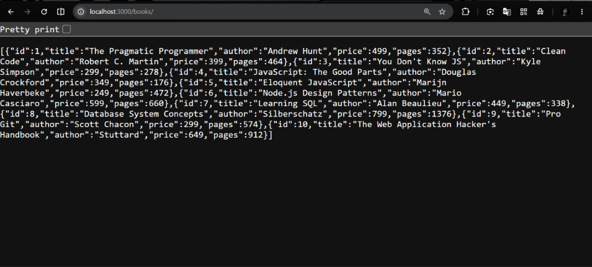
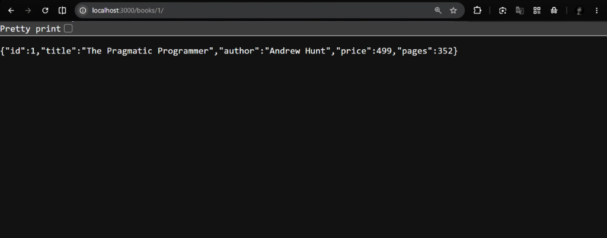
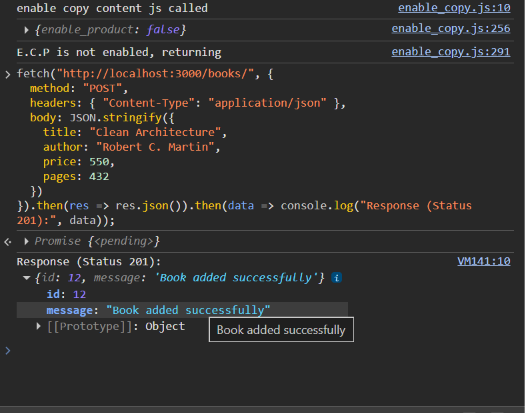
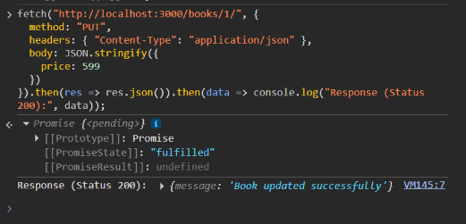
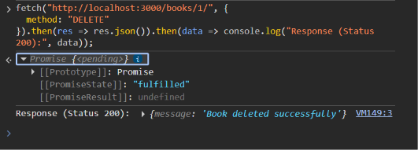
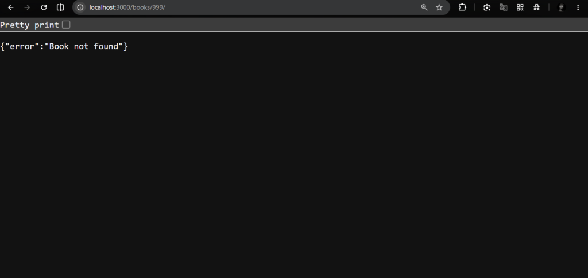

# Lab 2: SQLite Database and CRUD Routes

**Course:** Backend Development Fundamentals · Year II Term II · Aurora  
**Faculty:** Chintakrindi Sai Siva Teja

---

**Name:** Anudeep panakanti  
**Registration Number:** 214  
**Section:** 214 CSE-2D

---

## Live Link

>**Deployed Link:** https://bdf-lab-1-anudeep-214-8o4t.vercel.app/

---

## How to Run

### Prerequisites
- Node.js v18 or later
- npm (bundled with Node.js)

### Install & Start

```bash
# 1. Clone the repository
git clone https://github.com/panakantianudeep789/BDF-LAB1-Anudeep-214.git
cd BDF-LAB1-Anudeep-214/lab-02

# 2. Install dependencies
npm install

# 3. Start with nodemon (auto-restarts on file changes)
npm run dev

# OR start without nodemon
npm start
```

The server starts on **http://localhost:3000** by default.  
The database file `books.db` is created automatically on first run and seeded with 10 books.

### Environment Variables

| Variable | Description                | Example |
|----------|----------------------------|---------|
| `PORT`   | Port the server listens on | `3000`  |

> No `.env` file is needed for this lab — `PORT` falls back to `3000` if not set.

---

## Endpoints

| Method | Path               | Description                              | Status Codes  |
|--------|--------------------|------------------------------------------|---------------|
| GET    | `/books/`          | Fetch all books from the database        | 200           |
| GET    | `/books/:bookId/`  | Fetch a single book by its id            | 200, 404      |
| POST   | `/books/`          | Add a new book (JSON body required)      | 201, 400      |
| PUT    | `/books/:bookId/`  | Update an existing book by id            | 200, 404      |
| DELETE | `/books/:bookId/`  | Delete a book by id                      | 200, 404      |

### POST / PUT Request Body (JSON)

```json
{
  "title": "Book Title",
  "author": "Author Name",
  "price": 499,
  "pages": 350
}
```

---

## Screenshots

### GET `/books/` — All books (200)


### GET `/books/1/` — Single book (200)


### POST `/books/` — Add new book (201)


### PUT `/books/1/` — Update book (200)


### DELETE `/books/1/` — Delete book (200)


### GET `/books/999/` — Book not found (404)


---

## Project Structure

```
lab-02/
├── index.js        # Express server with all CRUD routes
├── books.db        # SQLite database file (auto-created on first run)
├── package.json    # Project metadata & scripts
├── .gitignore      # Excludes node_modules and .env
├── screenshots/    # Postman screenshots of all endpoints
└── README.md
```

---

## Viva Answers

**Q: Why await the database call?**  
SQLite operations (reading/writing the file on disk) are asynchronous I/O. Without `await`, the code continues before the database has returned its result, so you would get `undefined` instead of the actual rows. Using `async/await` makes the code wait for the promise to resolve before proceeding.

**Q: What is SQL injection and how do placeholders prevent it?**  
SQL injection is an attack where a user embeds SQL code in their input (e.g. `1 OR 1=1`) to manipulate the query. Placeholders (`?`) pass user input as data values, not as part of the SQL text — the database driver escapes them automatically, so injected code is never interpreted as SQL.

**Q: When is PUT used instead of POST?**  
POST is used to *create* a new resource when the server decides its id. PUT is used to *update* (or fully replace) an existing resource at a known URL — the client already knows the resource id (e.g. `/books/5/`). PUT is also idempotent: calling it multiple times with the same data produces the same result.

---

## Notes

- **Problem faced:** The server could start before the database connection was ready, causing crashes on the first request.
- **How solved:** Wrapped everything in `initializeDBAndServer()` — an async function that `await`s the DB connection and only then calls `app.listen()`.

